

  

<h1 align="center">Jigar Prajapati</h1>

<b>AI Automation Engineer</b> · Agentic systems, LLM workflows and intelligent process automation Ahmedabad, India · Remote

  
  
  

## About

I build AI agents, RPA and cloud-backed integrations that take over repetitive work and keep running without babysitting. I have 13 years of software experience, the last ones focused on Python automation, LLM workflows and AWS.

- **Now:** AI automation for Windows software and websites (Varium / Pensato), and the Drugstore2Door pharmacy platform on AWS
- **Before:** 70+ Adobe Commerce projects, from migrations to multi-vendor marketplaces
- **Tools I use:** Python, FastAPI, Playwright, TypeScript, PHP, PostgreSQL, AWS, Docker, GitHub Actions, Claude API, MCP, OpenAI-compatible local models

## Selected work

Most of my work is private, for clients or as personal products. These are anonymised summaries or illustrative diagrams with sample data. I'm happy to walk through architecture and demos on a call.

### AI and automation

**Windows and web automation.** Python bots that replay recorded user activity, read two-factor codes from email, handle image captchas and send email replies based on documents.

**Multi-LLM routing backend.** Each task goes to the right model, with logging and fallbacks.

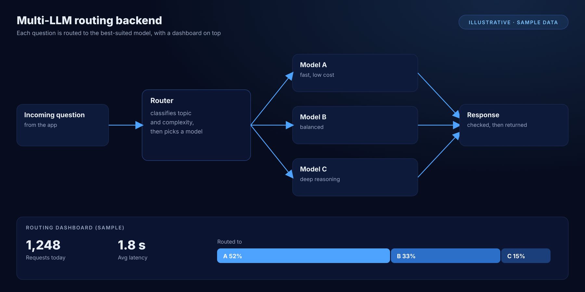

**Content agents.** An Instagram content engine, a Shorts factory and a LinkedIn agent, each with a human approval step.

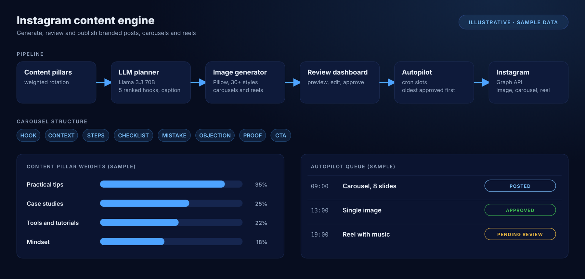

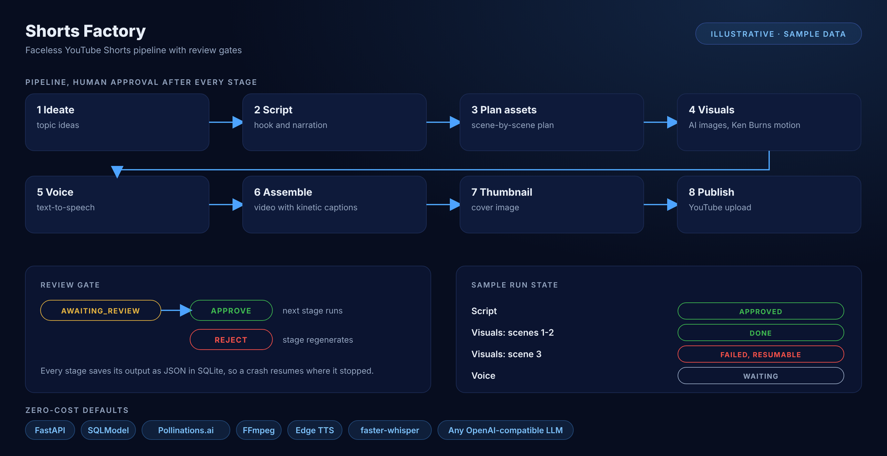

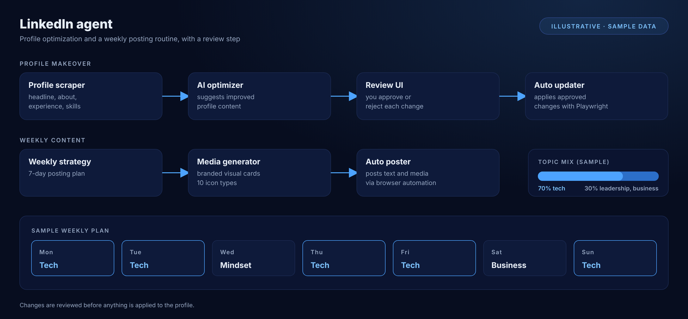

**Automation run monitor.** Every bot run is tracked. Failures retry, then alert through Telegram, Slack or email, so nothing fails silently.

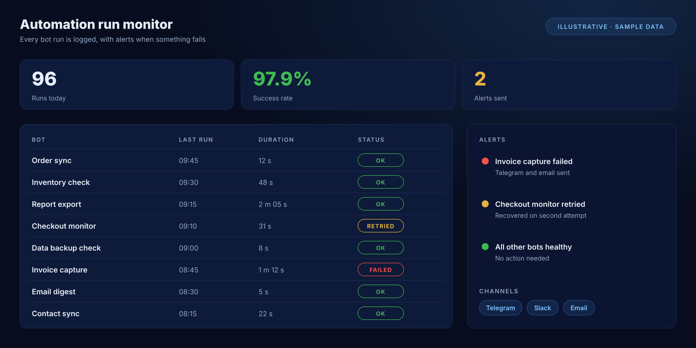

**Market-data and signal system.** Built to run continuously with retries, rate-limit handling and alerting.

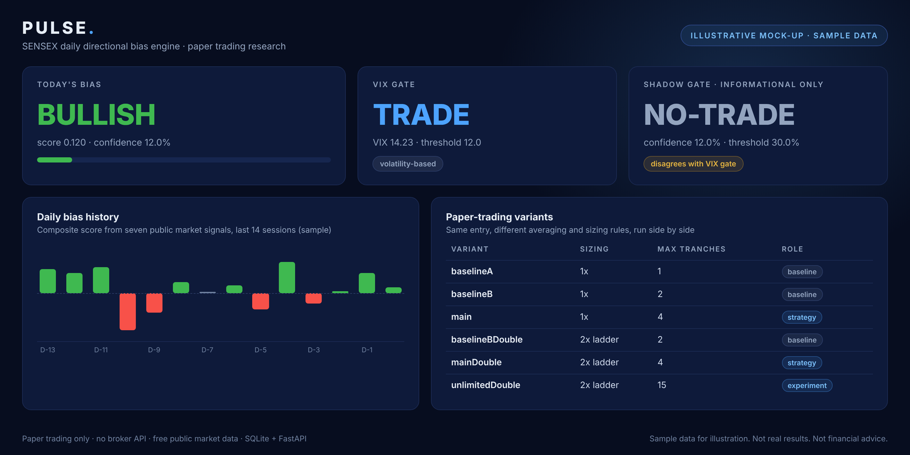

### Cloud and healthcare integrations

**Drugstore2Door (2021 to now).** I lead a 3-person team running 500+ pharmacy stores in a single Adobe Commerce database across multiple AWS instances. I built the pharmacy order portal, an order-linked SMS chat module, an advanced permissions module, subscription-based feature locking, a custom accessibility widget for 400+ live stores, and GitHub Actions pipelines with end-to-end tests after every deployment.

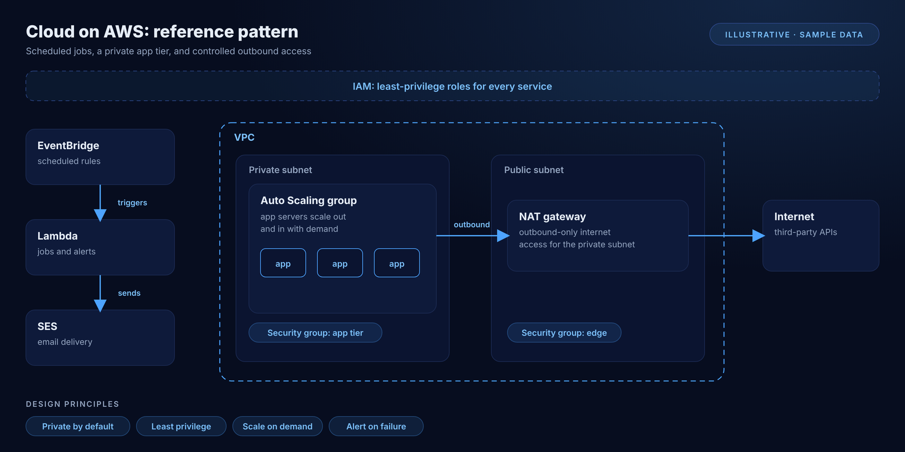

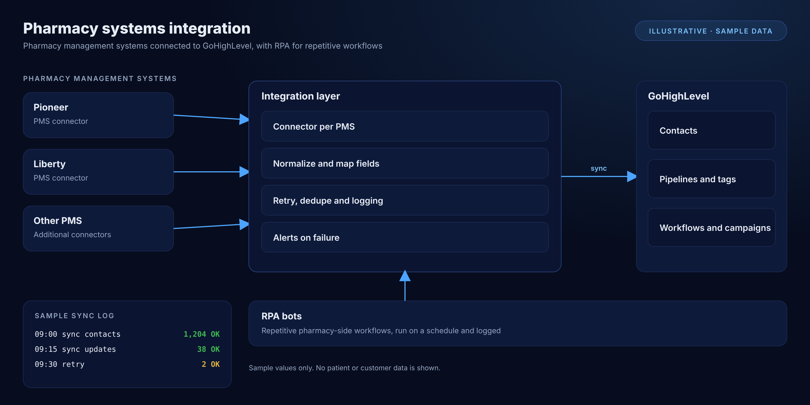

Since 2024 I also build a GoHighLevel marketplace app for the platform, with AWS security work for sensitive health data (private S3 buckets, access limited to the internal network). The work is HIPAA-relevant.

### E-commerce, earlier work

- **Custom box studio** for a packaging store: customers upload images, add text and change colours, and admins download a PDF for printing
- **Custom shipping module** replacing a slow carrier API, about 5 seconds faster per request
- **Power Music (2018):** three Adobe Commerce stores with music mixing and generation, and a custom subscription module
- **Bali Clicks (2019):** live preview that renders chosen charms onto bracelet photos
- **RoomService360 (2022):** custom cache layer, Varnish rules and full-page cache tuning
- **Artist stores** on one platform, including Coldplay, Ed Sheeran and Cigarettes After Sex
- **Mobile OTP login**, a WhatsApp Business integration through the Meta API, and a smart alert dashboard

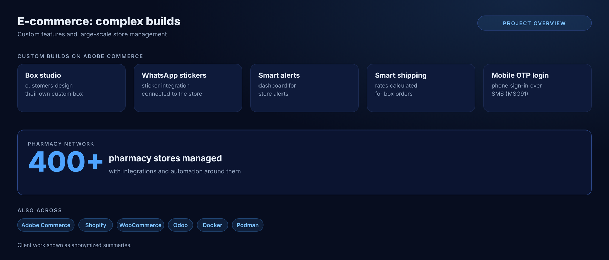

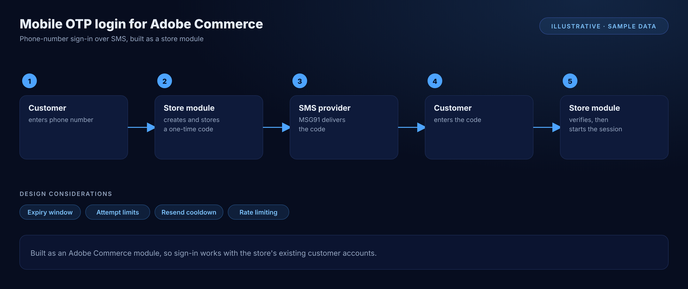

## Open source

Small, useful tools I publish in the open.

| Tool | What it does |
| --- | --- |
| [agent-risk-annotator](https://github.com/jigar48/agent-risk-annotator) | Local-first risk annotations for AI-agent-generated diffs, as a CLI, a Claude Code plugin and a GitHub Action |
| [awi](https://github.com/jigar48/awi) | Offline linter for AI agent traces: retry storms, repeated failing calls, cycles, resource burn |
| [mcp-agentmesh](https://github.com/jigar48/mcp-agentmesh) | Multi-agent pipeline with an architect, a coder and a security auditor sub-agent |
| [logpulse-ai](https://github.com/jigar48/logpulse-ai) | Terminal log debugger that masks secrets locally and exports a post-mortem |
| [agent-gauntlet](https://github.com/jigar48/agent-gauntlet) | Deterministic audit of a store checkout, run the way an AI shopping agent does (early release) |
| [checkout-canary](https://github.com/jigar48/checkout-canary) | Scheduled Playwright monitor that walks a store to the payment step and publishes a status page |
| [api-contract-diff](https://github.com/jigar48/api-contract-diff) | Detects removed endpoints and breaking changes between OpenAPI specs |
| [contact-cta-inspector](https://github.com/jigar48/contact-cta-inspector) | Privacy-first Chrome extension that checks WhatsApp, phone and email links |

  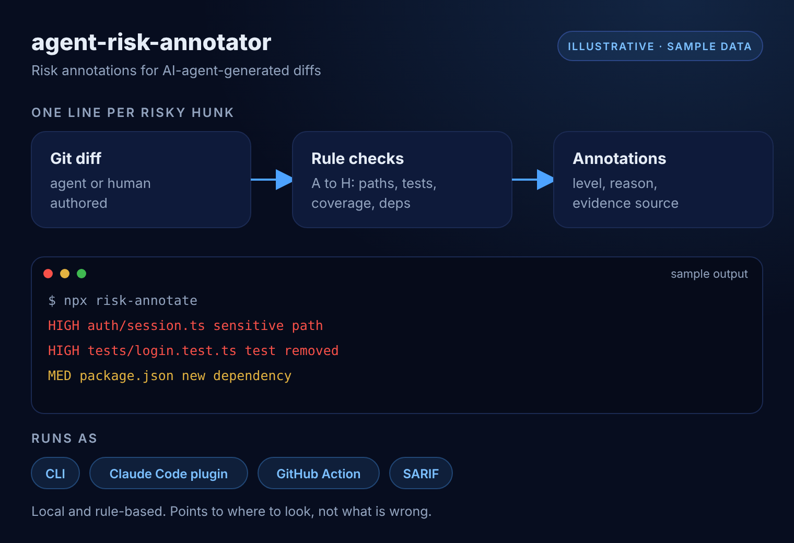 
  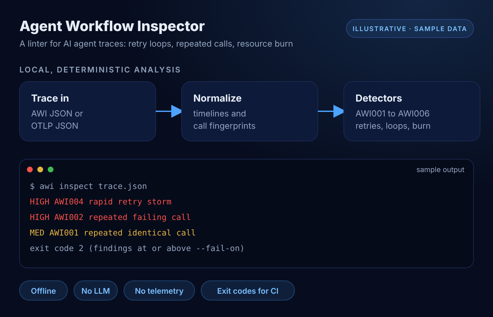 
  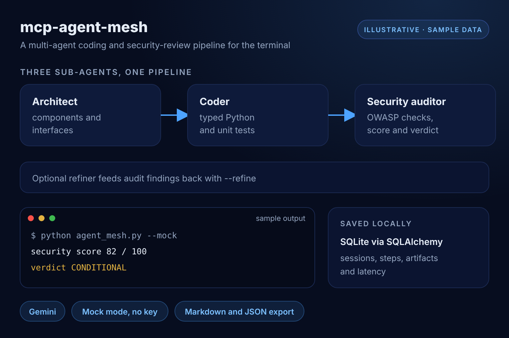 
  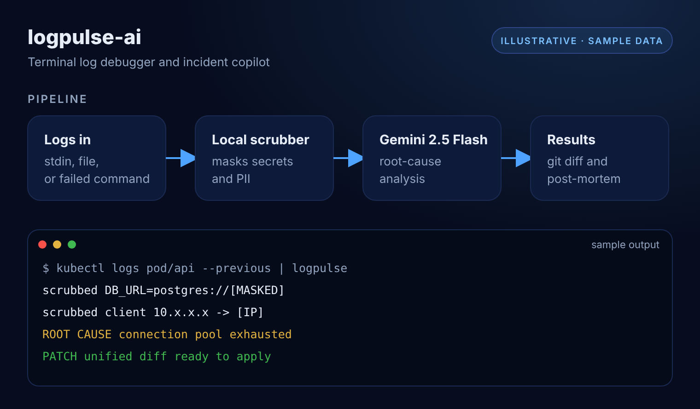 
  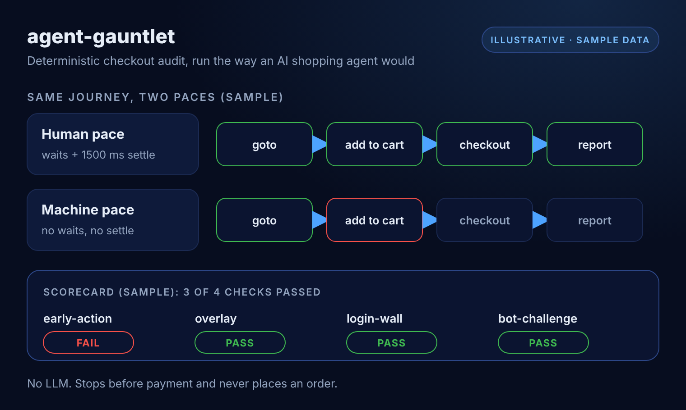 
  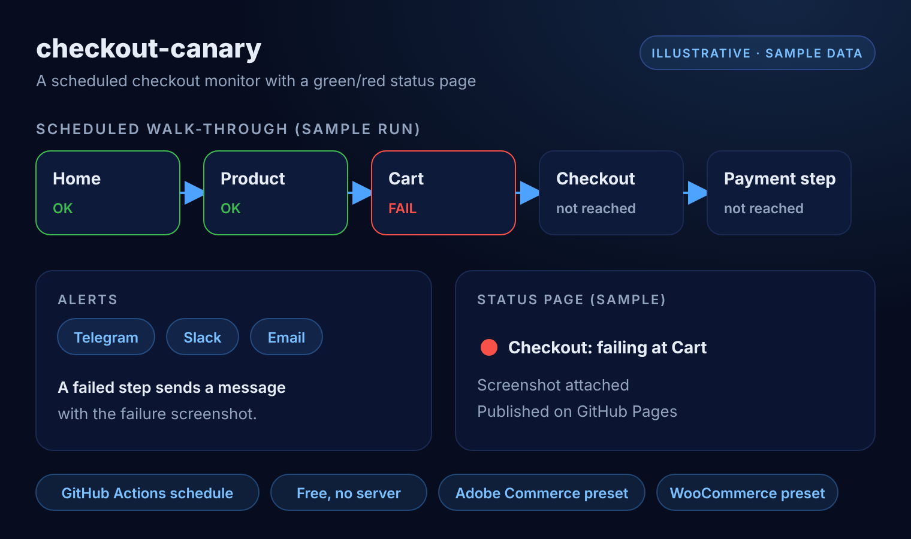 
  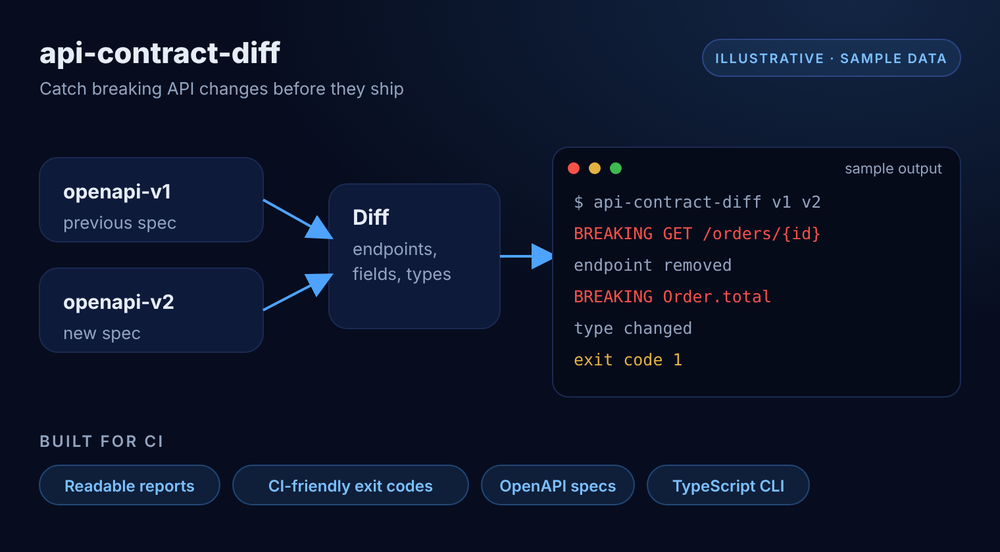 
  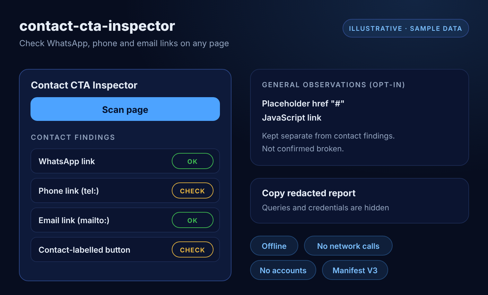

## Career

| Years | Role |
| --- | --- |
| 2024 to now | AI Automation Engineer, Varium / Pensato |
| 2021 to now | Lead Engineer and Cloud Architect, Drugstore2Door |
| 2025 to now | AI agents and developer tools, independent products and open source |
| Nov 2017 to 2024 | Founder and Principal Engineer, Petrichor IT Services |
| Jun 2013 to Oct 2017 | Lead Magento Developer, Aims Infosoft |

## Get in touch

Open to full-time remote roles in AI automation, agents and LLM workflows. Reach me on [LinkedIn](https://linkedin.com/in/buildaiwith-jigar-prajapati) or at jigar.prajapati48@gmail.com.

  

